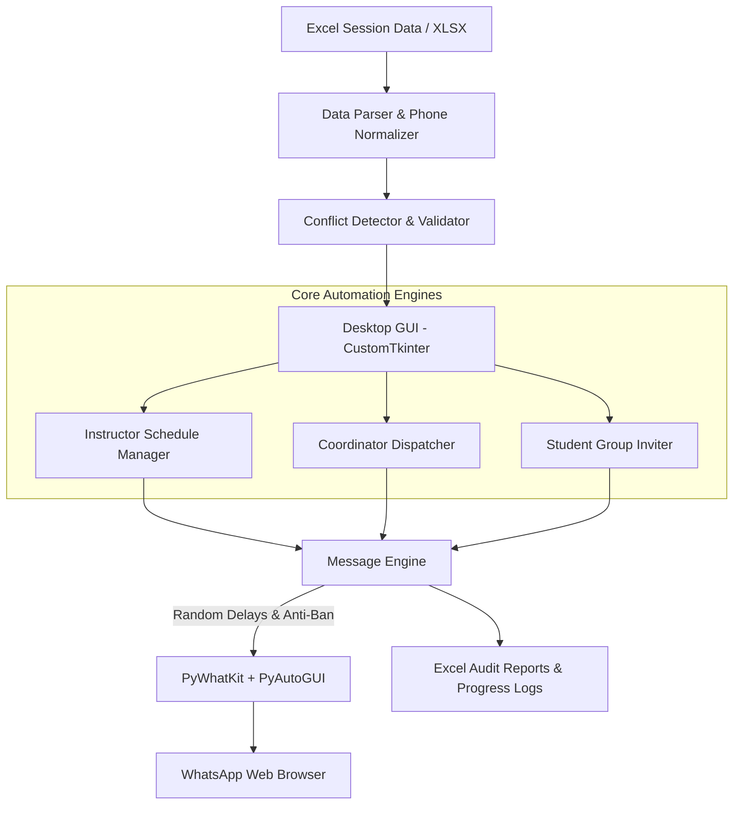

# Project Management Automation (PMA)

[](https://www.python.org/)
[](https://github.com/TomSchimansky/CustomTkinter)
[](https://github.com/Ankit404butfound/PyWhatKit)
[](https://pandas.pydata.org/)
[](https://www.microsoft.com/windows)
[](LICENSE)

> **A desktop application for automating WhatsApp communications, scheduling, conflict detection, and coordination across training centers, instructors, coordinators, and students.**

---

## Overview

**Project Management Automation (PMA)** is a modular desktop software application built with Python and **CustomTkinter**. Designed originally to streamline large-scale educational operations (such as **eYouth** training programs), it automates end-to-end communication pipelines via WhatsApp Web:

- **Instructor Session Operations:** Automated schedule-based reminders and session status tracking.
- **Coordinator Management:** Smart slot analysis, wage calculation, and assignment conflict detection with bilingual messaging (Arabic and English).
- **Student Group Invites:** Automated onboarding with personalized WhatsApp group invite links, progress tracking, and batch throttling.
- **Anti-Ban Architecture:** Humanized pacing, randomized delay intervals, and configurable daily limits to safeguard WhatsApp accounts.

---

## Key Features

### 1. Instructor Scheduling & Dispatch
- **Automated Triggers:** Sends reminders scheduled around session times:
  - **Day-Before Reminder** (`-24h`)
  - **Pre-Session Alert** (`-15m`)
  - **Waiting Room & Attendance Checks**
  - **Post-Session Wrap-Up & Feedback**
- **Dynamic Template Engine:** Personalizes messages using placeholders (`{name}`, `{group_code}`, `{time}`, etc.).
- **Live Status Tracking:** Visual indicators (`Not Sent`, `Sending`, `Sent`, `Failed`, `Acknowledged`, `Confirmed`).

### 2. Coordinator Workflow & Conflict Detection
- **Smart Column Auto-Detection:** Intelligently maps Excel header variations via canonical aliasing.
- **Assignment Conflict Detection:** Automatically flags coordinators scheduled for overlapping days and time slots.
- **Financial & Slot Analytics:** Calculates per-coordinator slot counts and estimated earnings.
- **Bilingual Arabic Messages:** Formats clear schedule summaries with Arabic weekday mapping and center details.

### 3. Student Group Invites
- **Automated Invitations:** Bulk-dispatches customized group links to students.
- **Resume & Persistence:** Saves progress to JSON (`group_invite_progress.json`) to safely resume paused or multi-day runs.
- **Daily Batch Quotas:** Enforces daily sending quotas to prevent spam detection.

### 4. Robust Anti-Ban & Human Simulation
- **Randomized Delays:** Simulates realistic typing and human pacing (20–40s for coordinators, 45–90s for students).
- **Phone Number Normalization:** Automatically standardizes international and Egyptian formats (`010...`, `+2010...`) into clean **E.164**.

### 5. Modern Dark-Themed GUI
- Clean CustomTkinter interface with smooth navigation.
- **Interactive Tour Guide:** Built-in onboarding walkthrough for first-time users.
- Live console and status dots for transparency during active runs.
- Standalone executable support via **PyInstaller**.

---

## System Architecture



---

## Project Structure

```text
ProjectManagementAutomation/
│
├── main.py                     # Main entry point & Instructor dashboard
├── app_config.py               # UI themes, color palettes, and global configs
├── engine.py                   # MessageEngine (WhatsApp Web driver, batching, delays)
├── schedule_manager.py         # ScheduleMixin for timed automated triggers
├── ui_components.py            # Custom reusable UI widgets (StatusDot, StyledButtons)
│
├── coordinator_ui.py           # Coordinator workflow interface & dialogs
├── coordinator_logic.py        # Coordinator message generation & conflict detection
├── coordinator_parser.py       # Smart Excel/CSV reader with column alias auto-detection
│
├── group_invite_ui.py          # Student group invite GUI
├── group_invite_logic.py       # Group invite queue, batching, and progress persistence
├── centers_ui.py               # Training centers management interface
├── centers_logic.py            # Center directory and room assignment logic
│
├── template_utils.py           # Template parsing, placeholder substitution, gender styling
├── report_generator.py         # PDF/Excel export utility
├── db_manager.py               # SQLite persistence manager
│
├── templates.json              # Instructor message templates
├── coordinator_templates.json  # Coordinator Arabic message templates
├── group_invite_templates.json # Student invite templates
├── triggers.json               # Schedule trigger definitions
├── schedules.json              # Cached schedule data
│
├── requirements.txt            # Python dependencies
└── main.spec                   # PyInstaller packaging specification
```

---

## Installation & Setup

### Prerequisites
- Python **3.10** or higher
- Google Chrome (or default browser logged into [WhatsApp Web](https://web.whatsapp.com/))
- Windows OS (recommended for PyAutoGUI automation hooks)

### 1. Clone the Repository
```bash
git clone https://github.com/osamaelfeky307/ProjectManagementAutomation.git
cd ProjectManagementAutomation
```

### 2. Create a Virtual Environment (Recommended)
```powershell
python -m venv .venv
.\.venv\Scripts\Activate.ps1
```

### 3. Install Dependencies
```bash
pip install -r requirements.txt
pip install pyautogui
```

---

## Usage

### Running the Application
```bash
python main.py
```

1. **Load Sessions:** Click **Browse File** and select your session Excel sheet (`.xlsx`).
2. **Review & Map:** Columns are automatically detected. Verify mappings and resolve any highlighted schedule conflicts.
3. **Choose Workflow:**
   - **Instructor Messaging:** Run immediate batches or enable background scheduled triggers.
   - **Coordinator Workflow:** Generate customized Arabic slot assignment messages with wage estimations.
   - **Group Invites:** Send group join links with daily batch limits.
4. **Export Reports:** Download processed audit logs and confirmation reports as `.xlsx`.

---

## Excel Template Structure

The parser supports flexible column naming, recognizing aliases automatically:

| Field | Example Accepted Headers |
|---|---|
| **Instructor / Coordinator Name** | `Instructor`, `Name`, `الاسم`, `Main Coordinator`, `Coordinator` |
| **Phone Number** | `Phone`, `Mobile`, `WhatsApp`, `رقم الهاتف`, `Contact` |
| **Group Code** | `Group`, `Group Code`, `كود الجروب`, `Batch` |
| **Session Day & Time** | `Day`, `اليوم`, `Time`, `الميعاد`, `Slot` |
| **Center / Room** | `Center`, `السنتر`, `Room`, `القاعة`, `Branch` |

---

## Building Standalone Executable

To compile into a standalone `.exe` using PyInstaller:

```bash
pyinstaller main.spec
```

The compiled binary will be generated in the `dist/` directory.

---

## Security & Privacy Notice

- **Local Storage:** All contacts, schedules, and configuration files are stored locally on your machine.
- **WhatsApp Terms of Service:** Always adhere to WhatsApp's Terms of Service. Use moderate delay settings and obtain consent from recipients to minimize account risk.

---

## Author

**Osama Elfeky**
- GitHub: [@osamaelfeky307](https://github.com/osamaelfeky307)
- Project: [ProjectManagementAutomation](https://github.com/osamaelfeky307/ProjectManagementAutomation)

---

## License

This project is licensed under the [MIT License](LICENSE).
